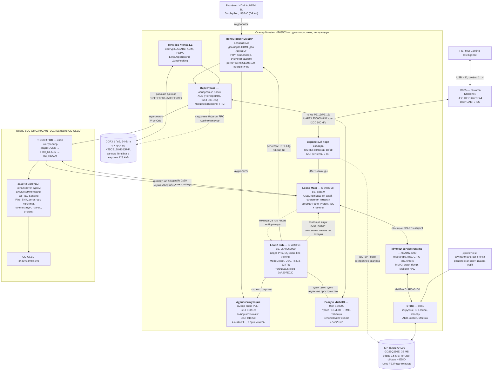

# Как устроен монитор: ядра, тракт сигнала и разделение обязанностей

Сводка по всему разобранному. Отвечает на вопрос, который возникает после разбора
Panel Protect: если панель так много делает сама, чем заняты четыре ядра скалера.

Короткий ответ: **панель отвечает за пиксели, скалер — за всё остальное.** Панель ничего
не знает про входы, режимы, разгон, меню, кнопки и питание; она получает готовый
видеопоток и десяток управляющих байт. Всё, что происходит от разъёма до этого потока,
делает скалер, и работы там на четыре ядра.

## Блок-схема



## Кто чем занят

### STBC (8051) — «дежурный по системе»

Единственное ядро, которое работает всегда, включая standby. Стартует первым: вектор
сброса `LJMP 0x13F7`, определяет тип SPI-флеша по таблице JEDEC, проверяет таблицу
разделов и запускает остальных. Дальше владеет флешем, читает кнопки с резисторной
лестницы через АЦП и общается с Leon2 Main через MailBox.

Почему отдельное ядро: в standby большая часть чипа обесточена, а кто-то должен
проснуться по кнопке. Для этого 8051 достаточно, и он дёшев по питанию.

### Leon2 Sub (SPARC) — «приёмная часть»

Всё, что происходит до того, как появилась картинка: PHY приёмников HDMI и DP,
сканирование EQ, обучение линка, определение режима, DSC, FRL от 3 до 12 ГГц.
Здесь же живут автоматы `DRV_HDMI_EQScan_FSM_*` и `DRV_HDMI21_RXDetect_FSM_LTS_*`.
Тракт разобран в `docs/video-input.md`: два порта HDMI и два линка DP, таблица линков
в DRAM, аудиокоммутация на девять приёмников и почтовый ящик наружу. Внутренности эквализации
и обучения линка — в `docs/link-training.md`.

Почему отдельное ядро: link training — это работа с жёсткими временными требованиями,
которую нельзя прерывать отрисовкой меню. Разбор это подтвердил: оба HDMI-автомата
работают по таймерам, а не в общем цикле, и у FRL есть жёсткие таймауты (200 мс на
LTS_3).

Полезное следствие для будущей отладки: **прошивка умеет рассказывать про этот тракт
сама**. Слово `0xA80785FC` — маска категорий отладочных сообщений (инициализация PHY,
весь EQ-скан по шагам, определение режима, InfoFrame, звук, HDCP), и в UART она даёт
готовый разбор происходящего. Упирается в открытый вопрос №5.

### Tensilica Xtensa — «ограничитель яркости»

Контур LDC: `ADIM`, `PDIM`, `LimitUpperBound`, `ZonePeakingPercent`, `GainFilterMode`,
таблицы `LDC_GainTable_ANV1..3`. У образа своя отладочная консоль, независимая от
остальных.

Почему отдельное ядро: это счёт на каждый кадр по зонам изображения, то есть
DSP-нагрузка, а не управление.

### Раздел id=0x0B (SPARC) — «тракт HDR»

Отдельно слинкованный сегмент на базе `0x9F1B0000`: применение статического HDR,
HLG, таблицы TMO. Исполняется **на ядре Leon2 Sub и в его же главном цикле**:
`DRV_HDR_ApplyStaticHDR` (`0x9F1C4134`) вызывается из цикла `0xA00608A0` обычным
`call`, а сам сегмент зовёт рантайм Sub по `0xA006xxxx` — то есть это одна программа
в одном адресном пространстве, а не отдельный образ (`docs/video-input.md`).

### Leon2 Main (SPARC) — «мозг прибора»

Самый большой образ (1,45 МБ, более половины флеша). Прикладной уровень целиком:
меню и все языковые ресурсы, EDID, состояния питания, обработка событий от кнопок и
DDC/CI, автомат Panel Protect и вся связь с панелью по I2C.

### Раздел id=0x0D — системный runtime Leon2 Main

Это не пятое ядро и не mask ROM, а маленькая вторая часть программы Main, загруженная
по `0xA0028000`. В её первых 4 КиБ лежат 256 trap vectors; reset настраивает стек и
переходит в прикладной код Main. В обратную сторону Main вызывает 37 экспортов runtime:
контроллер прерываний, GPIO и программный I2C master, таймеры, raw MMIO, ожидание sync,
аварийный дамп и общие mailbox-порталы.

Главный портал Main↔STBC начинается по `0x9F0A0100`. Функция отправки публикует в нём
слово `command | arg1<<8 | arg2<<16 | arg3<<24`; её адрес зависит от версии:
`0xA002F3EC` в FW.034 и `0xA002F770` в FW.037. Это объясняет связь прикладного Main с
драйверами флеша и standby в 8051. Полная карта `id=0x0D`, trap table, ABI и version
map — в `docs/scaler-service-runtime.md`.

## Внешний канал управления: ПК → U7005 → Leon2 Main

U7005 — отдельный микроконтроллер Nuvoton NUC1261, который перечисляется на ПК как
USB HID `1462:3FA4` и служит входом Gaming Intelligence в монитор. В обычном режиме
Report ID `0x01` несёт ASCII-кадры фиксированной длины. U7005 исполняет несколько
собственных команд, а остальные передаёт побайтно через **UART1, 250000 бод, 8N1** с
падов PE.12/PE.13. На стороне скалера их принимает служебный парсер `Uart3` Leon2 Main;
это не текстовая отладочная консоль `MDBG >>`.

Основные формы кадров:

```text
GET:  5 8 ID[4] index \r
SET:  5 b ID[4] index data[3] \r
ACK:  5 6 0 0 (+|-) \r
```

Так читаются серийный номер, версия прошивки, яркость и контраст и меняются настройки
OSD. Полный извлечённый из FW.034/FW.037 whitelist находится в
`docs/console-commands.md`. Важно, что операция `'8'` не гарантирует отсутствие
побочного эффекта: `580040:\r` не возвращает обычное значение, а вызывает у Leon2
Main обработчик `UartSetI2CEnable`.

PE.12/PE.13 физически образуют один переключаемый канал, а не независимые UART и I2C.
Переход в режим обновления согласован между двумя микросхемами:

1. ПК отправляет в Report ID `0x01` кадр `580040:\r`; U7005 передаёт восемь байт по
   UART1, а Leon2 Main переводит сервисный интерфейс скалера в I2C/ISP.
2. ПК отправляет локальную команду U7005 `01 e0 01`; MCU закрывает UART1,
   мультиплексирует PE.12/PE.13 из MFP3 в MFP4 и поднимает I2C0 на 100 кГц.
3. Report ID `0x04` становится транспортом сырых I2C-транзакций: адрес `0x6E` даёт
   доступ к регистрам скалера, `0xB0` — к его ISP-автомату записи SPI-флеша U4002.
4. После перезагрузки скалера команда `01 e0 00` закрывает I2C0 и возвращает U7005 в
   UART1 250000 8N1. Сама по себе она не выводит уже работающий скалер из ISP.

U7005 не разбирает образ прошивки и не пишет U4002 напрямую: он только меняет режим
своих общих падов и перевозит байты между USB и сервисным интерфейсом скалера.
Детальный разбор MCU — в `docs/mcu-u7005.md`, живой сеанс обновления — в
`docs/usb-isp-protocol.md`, протокол slave NT68503 — в
`docs/nt68503-i2c-service-protocol.md`, а системный runtime и mailbox — в
`docs/scaler-service-runtime.md`.

## Как сигнал доходит от разъёма до видеотракта

Подробности — в `docs/video-input.md`; здесь только то, что нужно для понимания схемы.

**Разъёмов четыре, приёмников в чипе — тоже четыре, но считаются они по-разному.**
HDMI-портов ровно два (регистровые окна `0xCF000000` и `0xCF001000`), DP-линков тоже
два — второй, по всей видимости, приходит с USB-C в режиме DP Alt; протокольную часть
USB-C (CC/PD) обслуживает 8051, так что в Sub он попадает уже просто как DisplayPort.

**Сначала линк надо поднять, и здесь три разных механизма** (`docs/link-training.md`).
Асимметрия между ними — не деталь реализации, а следствие стандартов:

| Тракт | Есть ли обратная связь с источником | Что подбирается |
|---|---|---|
| HDMI 2.0 / TMDS | **нет** | только своя аналоговая эквализация: усиление RVGA и пара RCT/CCT |
| HDMI 2.1 / FRL | да, протокол LTS | скорость линка 3–12 Гбит/с, 3 или 4 линии, предыскажение передатчика |
| DisplayPort | да, DPCD | скорость 8,1 → 5,4 → 2,7 → 1,62 Гбит/с, число линий 4 → 2 → 1 |

В HDMI 2.0 приёмник не может ни о чём попросить источник, поэтому единственная его
стратегия — перебирать собственные настройки, пока не перестанут сыпаться ошибки.
Судит он по счётчику ошибок символов SCDC; перебор идёт не по всем комбинациям, а по
зашитой в образ таблице из 24 пар R/C, отсортированной от длинного кабеля к короткому.
В HDMI 2.1 и DP, наоборот, идёт торг: приёмник просит понизить скорость или сменить
предыскажение, и линк сходится на том, что вытягивает кабель.

Оба HDMI-автомата (17 состояний у эквализации, 10 у FRL — по спецификации HDMI 2.1)
крутятся на таймерах, отдельно от главного цикла Sub. Это и есть та причина, по которой
приёмная часть вынесена на своё ядро: у обучения жёсткие временные рамки, его нельзя
прерывать отрисовкой меню.

**Между портом и трактом лежит слой линков.** Линк — это обученное соединение поверх
порта: свои тайминги, своё состояние, свой автомат. Слотов в таблице девять, из них
шесть обслуживаются каждый оборот главного цикла Sub. Портов при этом четыре, потому
что **один разъём HDMI занимает два слота — «как TMDS» и «как FRL»**: протоколы разные,
живым в каждый момент бывает один, а какой именно — решает EQ-фаза. Наверх слой отдаёт
единую структуру `Htotal/Vtotal/HDE/VDE/Clk/ColorSpace/ColorDepth`, и выше по тракту
уже неважно, HDMI это, DP или DP MST.

**Переменная частота кадров держится на том, чего в коде нет.** Adaptive-Sync (он же
FreeSync, он же G-SYNC Compatible — со стороны монитора это одно и то же) меняет частоту
кадров, растягивая вертикальное гашение, то есть `Vtotal` гуляет от кадра к кадру.
Главное требование к прошивке — **не принять это за смену режима**, иначе экран будет
пересинхронизироваться на каждом изменении fps. На DP это решено радикально: в детекторе
смены режима `Vtotal` не сравнивается вообще, только сохраняется. На HDMI порог ±5 строк
есть, но снимается, когда распознан FreeSync-пакет источника. Диапазон 48–240 Гц
объявляется в EDID, и пункт меню `Adaptive-Sync` работает подменой EDID на вариант с
занулённым диапазоном. Подробно — `docs/adaptive-sync.md`.

**Аудиокоммутация опознана отдельно от видеотракта.** `0xCF0111C0…0xCF0111D4`
выбирают один из четырёх audio PLL для источника, `0xCF011200…0xCF011218` —
аудиоисточник для девяти приёмников. Прежняя трактовка этих регистров как
видеокроссбара опровергнута; назначение «аудио» — вывод, а не прочитанное в
образе.

**Процессор пикселей не касается.** Leon2 Sub программирует PHY, эквализацию
и другие регистры. Видеопоток идёт по аппаратному тракту и доходит до панели
по V-by-One; рассмотренная аудиокоммутация не устанавливает путь пикселей.

**Путей к регистрам в чипе два, и их легко перепутать.** Блоки видеотракта и аудиокоммутации
адресуются напрямую в окне `0xCF000000` (байтовый регистр на каждые 4 байта адреса).
А у PHY и эквалайзера доступ страничный: номер регистра — это пара «страница:смещение»,
страница пишется в `0xCF03D004 + порт·4`, данные лежат в окне `0xCE008100`. Поэтому
числа вида `0x1178` из отладочных сообщений в первом окне не ищутся вовсе.

**Выбором входа Sub не управляет.** Номер приёмника приходит к нему командой из
почтового ящика `0x9F130100` — то есть пункт `Input Source` в меню, автоперебор входов
и выдержка 3–5 с (`docs/input-switching.md`) живут в прикладном слое, а Sub лишь
исполняет. Обратно в тот же ящик Sub кладёт описание сигнала по каждому входу.

## Что делает панель, а что скалер

Граница проходит чётко и в одном месте: **всё, что зависит от свойств конкретной
матрицы, ушло в панель.**

| Задача | Где исполняется | Что делает вторая сторона |
|---|---|---|
| Циклы компенсации (OFF/EL Sensing) | Панель | Скалер решает **когда** и командует, ждёт сигнал |
| Детекция логотипа, панели задач, границ, статики | Панель | Скалер только включает и задаёт уровень |
| Сдвиг пикселей | Панель | Скалер задаёт вкл/выкл и скорость |
| Температурная защита | Оба | Скалер читает температуру и блокирует циклы выше 46 °C |
| Ограничение яркости (ABL) | Оба, граница не установлена | См. ниже |
| Динамическая контрастность (ACE) | Скалер | Панель получает готовое усиление |
| Переменная частота кадров (VRR) | Оба | Скалер объявляет диапазон в EDID и терпит плавающий `Vtotal`, панель отрабатывает сам кадровый интервал |
| Яркость, режимы, HDR, тайминги, DSC | Скалер | — |
| Меню, кнопки, входы, питание | Скалер | — |

Причина такого деления понятна из физики: компенсация требует измерять деградацию
конкретных пикселей и хранить накопленную историю. Это данные матрицы, они
привязаны к экземпляру и живут вместе с ним. Скалер их не видит и заменяем без потери
этих данных.

## Как это работает по шагам

1. **Питание.** 8051 стартует, определяет флеш, проверяет таблицу разделов, поднимает
   остальные ядра.
2. **Панель.** Leon2 Main ведёт последовательность `DVDD_ON → FRC_READY → IIC_READY`.
   До готовности I2C команды панели не проходят, и прошивка это проверяет перед
   каждой записью.
3. **Сигнал.** Leon2 Sub обнаруживает источник и поднимает линк: для HDMI 2.0 подбирает
   эквализацию перебором по таблице, для HDMI 2.1 и DP торгуется с источником о скорости
   и предыскажении. Дальше определяет режим и при необходимости включает DSC.
   Готовые тайминги он кладёт в таблицу линков и
   отправляет пакетом в почтовый ящик. Оттуда же приходят команды управления
   приёмниками и выбора аудиоисточника.
4. **Картинка.** Видеотракт масштабирует и обрабатывает кадр; Tensilica считает
   ограничение яркости, раздел 0x0B применяет HDR, блок ACE строит гистограмму,
   и Leon2 Main по ней ведёт усиление панели через регистр `0x05E`.
5. **Работа.** Main обслуживает меню и кнопки (события приходят от 8051 через MailBox),
   применяет настройки, а панель самостоятельно следит за статикой и двигает пиксели.
6. **Выключение.** Main уводит систему в `APPSetPowerOff`, и там же принимает решение
   о цикле компенсации: если наработка достаточна и температура ниже 46 °C —
   запускается OFF Sensing, потом EL Sensing. 8051 остаётся в standby ждать кнопку.

## Что здесь вывод, а не факт

- **Назначение ядер по ролям** опирается на строки и разобранный код, но целиком
  ни одно ядро не прочитано. У Tensilica база загрузки с тех пор установлена
  (`docs/tensilica.md`), и её роль подтверждена уже кодом, а не только строками:
  параметры LDC/ABL и таблицы усиления найдены по адресам.
- **Разделение ABL между Tensilica и панелью не установлено.** Параметры `ADIM` и
  `LimitUpperBound` в скалере есть, «lum mode» у панели тоже есть; кто кого
  ограничивает в итоге и складываются ли они — не разобрано. Это главная нерешённая
  развилка в схеме.
- **Аппаратный видеотракт** на схеме показан укрупнённо. Полная маршрутизация
  пикселей между блоками не восстановлена; прежний «входной кроссбар» оказался аудио.
- **Назначения девяти аудиоприёмников** частично восстановлены: DAC, DP/HDMI TX
  audio, SPDIF, I2S. Это вывод, а не прочитанное в образе. Наличие и разводка
  каждого выхода на плате MSI не проверены; приёмник 8 неизвестен. См.
  `video-input.md`.
- **Второй DP-линк = USB-C** — вывод из состава разъёмов монитора, а не из образа:
  имён разъёмов в Leon2 Sub нет.
- **Что детектор пакетов в Sub — это детектор FreeSync**, следует из идентификатора
  `0x00001A` (IEEE OUI AMD) в разбираемом пакете, а не из имён в коде. Для NVIDIA он не
  срабатывает, и это не мешает G-SYNC Compatible работать: на DP терпимость к плавающему
  `Vtotal` безусловная.
- **Смысл настроек эквалайзера** (RVGA — усиление, RCT и CCT — сопротивление и ёмкость)
  взят из отладочных строк прошивки и общепринятой схемы адаптивного приёмника; из
  образа физика не следует. То же с трактовкой таблицы 24 пар как «от длинного кабеля к
  короткому» — это вывод из того, что ёмкость в ней убывает.
- **Адресат почтового ящика** `0x9F130100` не доказан. По именам команд
  (`_SetLeonSPowerDown`, `Leon2M write Link%d MST EDID`) это Leon2 Main, но в его
  образе нет ни одной ссылки на это окно. На схеме связь показана пунктиром.
- **Интерфейс до панели — V-by-One**, и это уже не только вывод из образа. По строкам в
  Leon2 Main (`Vx1RxLink_Initial`, `Vx1 Lane BW = %ld`, `ResetVx1`; LVDS и eDP в образе
  не встречаются) — и, независимо, по силкскрину на плате модуля панели: цепи
  `VB0P/VB0N`…`VB15P/VB15N` и режимные выводы `VX1_M0`/`VX1_M1`, то есть **16 линий**
  (`docs/hardware-boards.md`). Сам код V-by-One не читался.
- **Дискретные линии** между скалером и панелью показаны по способу обращения к ним
  (`func_0xa002caf4(номер, маска)`), сами номера выводов не проверены. Со стороны платы
  панели у них есть имена: `AC_DET`, `S_DONE`, `ERR_DET`, `VDD_DET`, `LOCKN`, `AG_S`,
  `HTPDN`, `TCON_WDT` плюс отдельная пара I2C `SDA_I`/`SCL_I`
  (`docs/hardware-boards.md`). Сопоставление имён с номерами выводов не сделано.
