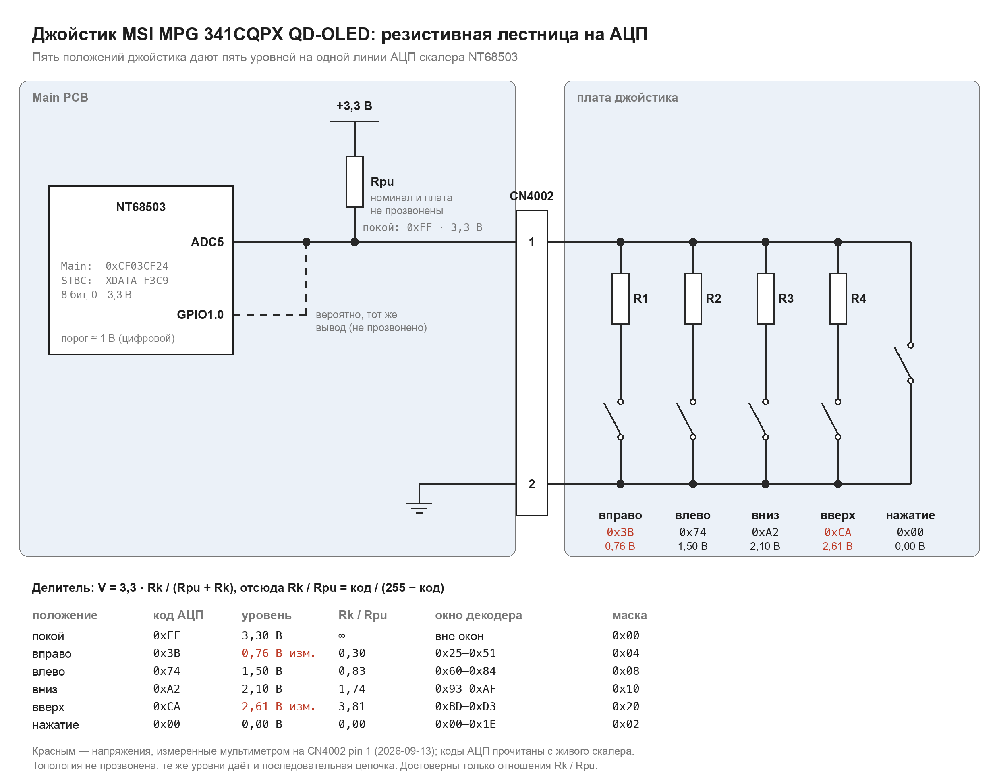

# Кнопки: обработка нажатий и комбинации

Монитор физически имеет: кнопку питания, функциональную кнопку и джойстик
(4 направления + нажатие) — итого 7 входов.

## Путь события

В рабочем режиме ON Leon2 Main сам читает ADC и формирует события джойстика:

```
Leon2 Main: ADC_Read(5), 0x0007A6A8 → MMIO 0xCF03CF24; отдельный GPIO по таблице
   └─> KEY_DecodeAdcToMask, 0x000C2030
        └─> KEY_ReadRawMask, 0x000C23C8       стабилизация маски
             └─> 0x0002D9D8                 маска → событие кнопки
                  └─> очередь 0xA8029B08     до 10 событий, счётчик 0xA8029B01
                       └─> 0x00029ED4        обработка очереди Main
                            └─> 0x000240B4   APPActionDispatcher
                                 └─> таблица 0x00025384, действия 0x00–0x3E
```

Адреса функций здесь относятся к FW.037. Цепочка чтения и формирования события
не требует доставки нажатия через Mailbox STBC. Это уточнение от2026-09-19
исправляет раннюю схему «8051 → MailBox → Main» и опечатку адреса обработчика
очереди. Прямое чтение подтверждено Ghidra (`ADC_Read` case5, вызовы
C2030→7A6A8, C23C8→C2030, 2D9D8→C23C8, 29ED4→2D9D8) и ранее измеренным
ADC на живом мониторе ниже. Это не означает, что Main вообще не обращается
к STBC при других действиях меню.

Main сам читает ADC/GPIO; обычное нажатие Power в состоянии ON не следует
считать mailbox-событием. Положительный FW.034 путь
`GPIO2.1 → event40 → APPSTATE_PWR_ONOFF` и его физические ограничения
разобраны в прикладном power dispatcher (не опубликовано).

Во сне/программном выключении STBC использует отдельный `KeyDetArray` для
пробуждения; это другой путь, описанный в конце документа. Соответственно,
диагностический Q собственной STBC не является журналом нажатий в ON.
Наблюдение владельца: OSD появляется без строк STBC UART (не опубликовано).

Диспетчер разбирает старшие два бита кода события:

| Старшие биты | Класс | Карта индексов | Таблица действий |
|---|---|---|---|
| `00` | APP | 0x0FAC30 | 0x0FABF8 |
| `01` | **Key** | **0x0FACD0** | **0x0FACA0** |
| `10` | OSD | 0x0FAC98 | 0x0FAC80 |
| `11` | DDC/CI | 0x0FAC78 | 0x0FAC70 |

То есть события кнопок — это `0x40 | код`, где код занимает младшие 6 бит.

## Декодер ADC и назначение кнопок

**`FUN_000C2030`** (Main 0x000C2030) превращает уровень ADC в маску:

```c
adc = ADC_Read();                                  // FUN_0007A6A8
m = 0;
if      (adc            < 0x1F) m = 0x02;
else if ((adc-0x25)&0xFF< 0x2D) m = 0x04;
else if ((adc-0x60)&0xFF< 0x25) m = 0x08;
else if ((adc+0x6D)&0xFF< 0x1D) m = 0x10;
else if ((adc+0x43)&0xFF< 0x17) m = 0x20;
...
return gpio_bit | m;                               // gpio_bit — 0 или 1
```

| Диапазон ADC | Маска | Физический ввод | Живое значение |
|---|---|---|---:|
| 0x00–0x1E | 0x02 | нажатие джойстика | — |
| 0x25–0x51 | 0x04 | вправо | `0x3B` |
| 0x60–0x84 | 0x08 | влево | `0x74` |
| 0x93–0xAF | 0x10 | вниз | `0xA2` |
| 0xBD–0xD3 | 0x20 | вверх | `0xCA` |

Между диапазонами оставлены зазоры — это защита от дребезга и разброса резисторов.

### Физические линии на CN4002 — измерено 2026-09-13

Мультиметр подтвердил устройство шлейфа органов управления:

| Pin CN4002 | Сигнал | Проверка |
|---:|---|---|
| 1 | аналоговая лестница джойстика | `3,3 В` в покое, около `0,76 В` вправо и `2,6 В` вверх |
| 2 | GND/возврат джойстика | `0,7 Ом` до GND без питания |
| 3 | функциональная кнопка, активный ноль | `3,3 В` отпущена и `0 В` нажата в `ON` |
| 4 | Power, активный ноль | `3,3 В` отпущена во всех трёх состояниях; при нажатии `0 В` |
| 5 | GND/возврат кнопок | `0,7 Ом` до GND без питания |

Остальные pins 6–8 принадлежат двухцветному LED и от органов управления не меняются.
Полная распиновка и уровни в `ON`/`POWERSAVING`/`POWEROFF` —
[`hardware-boards.md`](hardware-boards.md#cn4002-джойстик-кнопки-и-двухцветный-led--измерено-2026-09-13).

Напряжения крайних направлений независимо сходятся с цифровыми значениями ADC:
`0x3B / 255 × 3,3 В = 0,76 В`, `0xCA / 255 × 3,3 В = 2,61 В`. Значит pin 1 — именно
вход описанного ниже декодера, а не просто соседняя линия, реагирующая на джойстик.

### Схема лестницы



Картинка собирается `tools/joystick_ladder.py -o docs/joystick_ladder.png` из кодов
этого документа.

**Установлено.** В покое линия держится на 3,3 В (`0xFF`), каждое положение
джойстика опускает её на свой уровень, а нажатие — в ноль. Два напряжения измерены
мультиметром, все пять кодов прочитаны с живого скалера.

**Выведено.** Подъём линии к 3,3 В в покое и падение при нажатии означают подтяжку
`Rpu` к питанию и делитель `V = 3,3 · Rk / (Rpu + Rk)`. Отсюда
`Rk / Rpu = код / (255 − код)`: вправо `0,30`, влево `0,83`, вниз `1,74`, вверх
`3,81`, нажатие `0` (прямое замыкание). Абсолютные номиналы из кодов не следуют: при
`Rpu = 10 кОм` вышло бы около 3,0 / 8,3 / 17 / 38 кОм, но `Rpu` не найден. Неизвестно
и на какой плате он стоит.

**Не установлено.** Топология: те же уровни дают и параллельная лестница (на схеме),
и последовательная цепочка с отводами, замыкаемыми на землю (звенья ≈ 0,30 / 0,53 /
0,91 / 2,07 · `Rpu`). Различит их прозвонка платы джойстика без питания: сопротивление
pin 1–pin 2 в каждом удержанном положении. Что `GPIO1.0` — тот же вывод, что и ADC5,
тоже вывод из совпадения: он падает только вправо (0,76 В) и при нажатии, то есть его
цифровой порог лежит между 0,76 и 1,50 В.

**Лестница читается на живом мониторе, 2026-08-30.** `ADC_Read` берёт данные из блока
`0xCF03CF14…0xCF03CF58` (одиннадцать каналов по байту); клавиатура сидит на
**`0xCF03CF24`**. Снято консолью Leon2 Main:

```
mdw 0xCF03CF24 1   →  0xFF в покое,  0x3B при удержании вправо
```

`0x3B` попадает в диапазон `0x25–0x51`, то есть маска `0x04` — разбор порогов
подтверждён на железе. Покойные `0xFF` лежат вне всех пяти диапазонов, как и должно
быть, когда ничего не нажато. Тот же вывод виден и цифрой: **банк 1 бит 0** `DATA`
меняется `1 → 0` синхронно (`docs/uart-console.md`).

**Функциональная кнопка физически исправна, но на GPIO скалера не приходит.** Проверка
2026-08-30 не увидела её ни в одном из 17 банков `DATA`, а измерение 2026-09-13
показало чистый переход `3,3 → 0 В` на pin 3 `CN4002`. Значит прежний отрицательный
результат относится именно к предполагаемому scaler GPIO, а не к кнопке или шлейфу.
Монитор на нажатие внешне не реагирует даже когда утилита MSI назначила кнопке
действие. Кто читает физическую линию pin 3 и почему событие не доходит до Main, —
открыто; кандидаты — STBC и включённый только в `ON` U7005.

**Ключевое свойство: это цепочка `if / else if`.** Она возвращает ровно один бит
из пяти. Бит 0 (`0x01`) приходит отдельно, с GPIO, и объединяется по OR.

### Назначение кнопок

Пять уровней ADC — это резистивная лестница джойстика (нажатие + четыре
направления), шестой вход отдельный:

| Бит | Маска | Кнопка | Событие |
|---|---|---|---|
| 0 | `0x01` | **кнопка Power** (CN4002 pin4 → GPIO2.1, живой опыт 2026-09-26) | 0x40 |
| 1 | `0x02` | **нажатие на джойстик** | 0x41 |
| 2 | `0x04` | джойстик вправо (`direction 1`, ADC `0x3B`) | 0x48 |
| 3 | `0x08` | джойстик влево (`direction 2`, ADC `0x74`) | 0x47 |
| 4 | `0x10` | джойстик вниз (`direction 3`, ADC `0xA2`) | 0x46 |
| 5 | `0x20` | джойстик вверх (`direction 4`, ADC `0xCA`) | 0x45 |

Бит 1 определён надёжно: именно маска `0x02` включает заводской режим при холодном
старте, а документированная процедура требует удерживать **нажатие на джойстик**.

Бит 0 — единственный не с ADC. Прежнее имя «функциональная кнопка» было
выводом по исключению и отозвано: работа STBC в standby не исключает
локальный power-handler Main в ON. В FW.034 event `0x40` действительно
выбирает `APPSTATE_PWR_ONOFF`. **Связь с кнопкой Power установлена
2026-09-26** монитором входов собственного Main: три нажатия Power дали три
пары `GPIO2.1 1→0→1`, других изменений GPIO нет
(опыт 07513eae (не опубликовано)).

### Таблица GPIO-кнопок: восемь слотов, занят один

Откуда берётся `gpio_bit`: `FUN_000C2030` читает описания GPIO-кнопок из таблицы
**Main `0x0015DB58`** — 8 записей по 3 байта `[банк][маска][активный уровень]`. Слот с
банком `0xFF` пропускается, за таблицей лежит запись-страж `FF 00 00`.

| Слот (бит маски) | Банк | Маска | Уровень | |
|---:|---:|---:|---:|---|
| 0 | `02` | `0x02` | `0` | кнопка Power, активный ноль (живой опыт 2026-09-26) |
| 1…7 | `FF` | — | — | вывод не назначен |

Тот же слот в FW.034 — таблица по адресу Main `0x15D7D0`, содержимое байт в байт.

Два следствия. Во-первых, по конфигурации `gpio_bit` — это
`(GPIO_Read(банк 2, маска 0x02) == 0)`: вход активен нулём, а `DIR` банка 2 = `F7`
действительно объявляет bit 1 входом. Во-вторых, платформа умеет опрашивать до восьми
отдельных GPIO-кнопок, но в FW.034/FW.037 заполнен ровно один слот.

Живое измерение теперь отделяет конфигурацию платформы от разводки этого монитора:
функциональная кнопка исправно замыкает pin 3 `CN4002` на ноль, но bank 2 bit 1 и
остальные scaler GPIO при этом не меняются. Следовательно, запись `2.1` не подтверждает привязку к этой
функциональной кнопке. Внутреннюю `SW4101` штатный сканер также не
видит; полный разбор — в [`sw4101-button.md`](sw4101-button.md).

**Опыт 2026-09-26 закрыл привязку** (07513eae, C64 (не опубликовано)). Собственный
Main раз в 10 мс читал DATA всех 17 банков GPIO (входы по холодному DIR) и
десять байт АЦП `CF03CF14..CF30/CF54/CF58`:

- **Power** (pin 4): `GPIO2.1 1→0` на всё время нажатия, одновременно байт АЦП
  `CF03CF18` `FF→00`. Вероятно, это тот же вывод, прочитанный каналом АЦП
  (вывод из совпадения, не проверено). Запись слота 0 и условие пробуждения
  STBC `[12,01]` описывают именно Power.
- **Функциональная кнопка** (pin 3): три нажатия не изменили ни одного входа
  GPIO и ни одного из десяти байт АЦП. Её сигнал идёт мимо этих входов
  скалера; куда — не установлено.
- **Джойстик**: `CF24` вверх `CA`, вниз `A2`, влево `74`, вправо `3B`,
  нажатие `00`. `GPIO1.0` падает только вправо и при нажатии.

По коду физическое направление определить было нельзя: оно зависит от разводки
лестницы. Карта выше измерена на живом мониторе 2026-09-12 ранним опросом
`bootloader-libre`; четыре значения попали внутрь предсказанных диапазонов без
пограничных случаев.

### Опрос из `bootloader-libre`

Свободный первичный загрузчик теперь умеет включить канал 5 АЦП, один раз прочитать
`XDATA:F3C9` и вывести `direction 1`…`direction 4` вместе с сырым уровнем. Это тот же
регистр, который Main видит по `0xCF03CF24`. Опрос не ждёт нажатия: направление надо
удерживать во время reset, после единственной выборки загрузка продолжается.

Четыре аппаратных запуска дали полную карту: вправо — `direction 1`, ADC `0x3B`;
влево — `2`, `0x74`; вниз — `3`, `0xA2`; вверх — `4`, `0xCA`. Владелец одновременно
подтвердил, что после каждого запуска монитор продолжает работать. Текущий код и
статическая проверка описаны в
[`firmware/bootloader-libre/README.md`](../firmware/bootloader-libre/README.md#ранний-опрос-джойстика);
записанный вариант тем самым проверен аппаратным reset и живым UART.

## Таблица кнопок (Main 0x000FC238)

16 записей по 2 байта: `[битовая маска нажатых кнопок][код события]`.

| Маска | Биты | Код события | Что это |
|---|---|---|---|
| `0x00` | — | `0x4F` | ничего не нажато |
| `0x01` | 0 | `0x40` | одиночная кнопка |
| `0x02` | 1 | `0x41` | одиночная кнопка |
| `0x04` | 2 | `0x48` | одиночная кнопка |
| `0x08` | 3 | `0x47` | одиночная кнопка |
| `0x10` | 4 | `0x46` | одиночная кнопка |
| `0x20` | 5 | `0x45` | одиночная кнопка |
| **`0x31`** | **0 + 4 + 5** | **`0x49`** | **комбинация трёх кнопок** |
| **`0x03`** | **0 + 1** | **`0x4B`** | **комбинация двух кнопок** |

Используется шесть бит: пять состояний ADC и один отдельный GPIO.
Это программная конфигурация; она не устанавливает разводку шестой кнопки.

## Найденные комбинации

Это прямой ответ на вопрос: **скрытые комбинации в прошивке есть**, они заданы
таблицей, а не вычисляются.

### Комбинация `0x31` — три кнопки одновременно

Даёт событие `0x49`, карта переводит его в действие **0x3C**, обработчик — 0x00024310:

```asm
sethi 0x2a00af, %o4        ; база 0xA802BC00
ld    [%o4+0x174], %o5     ; флаговое слово 0xA802BD74
sethi 0x10, %g1            ; маска 0x4000 (бит 14)
andcc %o5, %g1, %g0
be,a  -> or  %o5,%g1,%g1   ; если бит сброшен — установить
         andn %o5,%g1,%g1  ; если установлен — сбросить
st    %g1, [%o4+0x174]     ; => ПЕРЕКЛЮЧЕНИЕ бита 14
mov   0xfe, %o0
call  0xe7648              ; вызов с (0xFE, 1)
call  0x21d10 (2)
```

То есть комбинация **переключает бит 14** в системном флаговом слове и дёргает
функцию с идентификатором `0xFE`. Что именно означает бит 14, точно не установлено:
слово 0xA802BD74 общее, к нему 42 обращения по всему коду. Известно, что тот же бит
устанавливается функцией 0x0006DF5C, сбрасывается в 0x0002D990, а в 0x0002F0D8
проверяется и вызывает то же `0xFE` с аргументом 0.

### Комбинация `0x03` — две кнопки одновременно

Даёт событие `0x4B`, но карта индексов переводит его в **10 — «игнорировать»**,
и данный диспетчер её не обрабатывает. Это не значит, что она мертва: насос очереди
передаёт каждое событие ещё трём обработчикам (0x0002F5A0, 0x0002D9D0, 0x00029CF8),
и она может потребляться там. Не проверено.

## Типы нажатия

Обработчик 0x0002D9D8 содержит автомат на 5 состояний (`_DAT_a8029b44` = 0…4):
обычное нажатие, автоповтор, длинное удержание, очень длинное, сброс.

Какие типы поддерживает каждая кнопка, задаётся битовыми масками, индексируемыми
номером кнопки: `_DAT_a8029b3c`, `_DAT_a8029b3a`, `_DAT_a8029b38`, `_DAT_a8029b20`.
Длительности берутся из `_DAT_a8024040`, `_DAT_a802403c`, `_DAT_a802403e`.

**Длинное удержание поддерживается на уровне механизма**, отдельно для каждой кнопки.

## Что в DRAM реально меняется от нажатия (живое измерение)

Снято на работающей FW.034 2026-08-22 пословным детектором изменений: резидент в
RAM-коридоре на каждом тике (1 кГц) сравнивает диапазон `0xA8029B00–0xA8029BFF` с
теневой копией и считает изменения по каждому слову. Инструмент и способ —
`docs/leon2-main-ram-development.md`, `tools/leon2_ram.py scan`.

**Снимками с хоста это не ловится.** Состояние нажатия транзиентное: главный цикл
разбирает событие за миллисекунды, и чтение через UART застаёт уже покой. Прямая
проверка: снимок после нажатия показал изменения только в кольце приёма консоли, то
есть эхо собственных команд.

Фон на покое за 5 с — всего три слова: `0xA8029BA4` (системный тик, 1 кГц),
`0xA8029B90` (та же частота) и `0xA8029B2C` (~0,86 кГц). Остальной диапазон неподвижен,
поэтому нажатие видно однозначно.

Контрольный опыт — **ровно три нажатия** кнопки «влево»:

| Адрес | Изменений | Чтение |
|---|---:|---|
| **`0xA8029B30`** | **6** | ровно 2 на нажатие — нажатие и отпускание |
| `0xA8029B40`, `B44`, `B48`, `B4C`, `B50`, `B54` | по 7 | блок автомата типов нажатия (`_DAT_a8029b44` — из них) |
| `0xA8029B34`, `0xA8029B5C` | 4 | сопутствующие |
| `0xA8029B38` | 2 | меняется не на каждое нажатие |
| `0xA8029B3C` | **0** | от самого нажатия **не зависит** |

Последняя строка важна: `_DAT_a8029b3c` из раздела «Типы нажатия» — это маска
свойств, индексируемая номером кнопки, и при нажатии она не переписывается. В более
раннем прогоне она росла, но от хождения по меню, а не от кнопки; трактовать её как
признак нажатия нельзя.

Медленная периодика `0xA8029B9C`, `0xA8029B78`, `0xA8029B68` идёт на 0,1–0,2 Гц и от
кнопок не зависит.

**Практический вывод: `0xA8029B30` — самый чистый признак нажатия**, ровно два
изменения на цикл кнопки. Проверено сквозняком: наблюдение за этим словом с
собственным обработчиком дало после пяти нажатий ровно десять вызовов.

**Границы измерения.** Нажималась только кнопка «влево». Меняются ли те же слова от
остальных шести входов и различается ли значение по номеру кнопки — не проверялось.
Диапазон осмотра ограничен `0xA8029B00–0xA8029BFF`; переменные вне его (например
`_DAT_a802badc`, `_DAT_a802bd74`) в этот счёт не входили.

## Две особенности обработчика

- **Подмена кода при старте.** Если счётчик `_DAT_a802baf4` меньше 1000, событие
  `0x40` заменяется на `0x4F`. Похоже на защиту от ложного срабатывания в первые
  моменты после включения.
- **Программная инъекция нажатия.** Если установлен бит 15 в `_DAT_a802badc`,
  в очередь дополнительно кладётся событие `0x41`, после чего бит снимается.
  То есть прошивка умеет имитировать нажатие кнопки изнутри — удобная точка
  для экспериментов при наличии UART-консоли.

## Вход в заводской режим при подаче питания

Найден полностью — и оказался не в 8051, а в прикладном слое Leon2 Main.

**`App_CoolInitialize` (Main 0x000269BC)** — процедура холодной инициализации:

```c
SYSAPI_GetPowerOnType();          // тип включения -> param_1
...
_DAT_a802badc = 0x2c00;           // биты 10, 11, 13; БИТ 11 взводит проверку кнопок
...
uVar4 = param_1 & 0xff;           // тип включения
if (uVar4 == 0) {                 // ТОЛЬКО при холодном старте
    FUN_0002d968();               // выборка состояния кнопок
}
...
if (uVar4 == 1) {                 // включение из дежурного режима
    _DAT_a802bd74 &= 0xffffbfff;  // бит 14 СБРАСЫВАЕТСЯ
}
```

Сама выборка — **`FUN_0002D968`** (Main 0x0002D968):

```c
key = KEY_ReadRawMask();                    // 0x000C23C8
if (_DAT_a802badc & 0x800) {                // если проверка взведена
    if (key == 2) _DAT_a802bd74 |=  0x4000; // маска 0x02 -> установить бит 14
    else          _DAT_a802bd74 &= ~0x4000; // иначе сбросить
}
_DAT_a802badc &= ~0x800;                    // одноразовая проверка
```

### Что из этого следует

**Бит 14 слова 0xA802BD74 — это и есть флаг заводского режима.** Именно он даёт
префикс «F» в заголовке OSD и доступ к сервисному меню.

Условия входа объясняют документированную процедуру целиком:

- проверка выполняется **только при типе включения 0** — холодный старт, то есть
  подача питания. Поэтому в инструкции требуется выдернуть и вставить кабель:
  при обычном включении кнопкой тип другой;
- включение из дежурного режима (тип 1) **явно сбрасывает** бит 14 — режим
  не переживает засыпание;
- удерживать надо кнопку с маской **`0x02`** (событие 0x41 в таблице кнопок).

### Комбинация трёх кнопок делает то же самое без перезагрузки

Действие 0x3C, на которое отображается комбинация `0x31`, **переключает тот же
бит 14**. То есть заводской режим можно включать и выключать на ходу, не трогая
питание. Это объясняет и назначение действия: оно не «что-то неизвестное»,
а runtime-переключатель заводского режима.

### Символ «F» действительно рисуется по биту 14 — доказано

Изначально это было **предположение**; проверка подтвердила. Функция **`0x0002F0D8`**:

```c
if (((_DAT_a802badc & 0x400) == 0) && (FUN_000d911c(), ret == 0xc)) {
    if ((_DAT_a802bd74 & 0x4000) == 0) {     // бит 14 сброшен
        _DAT_a8029b74 = 2;
        FUN_00052fc8(0, 1);
    } else {                                  // бит 14 установлен
        _DAT_a8029b74 = 1;
        FUN_000e2bb4(0xfe, 0);                // слой OSD 0xFE
        FUN_000e2af4(1, 5, 1, 0x592, 0);
        FUN_00041d40(&PTR_LAB_0015159c, 8);   // индекс 8 в таблице глифов
        FUN_0002e81c(0, 1, 5, 1, ...);        // вывести 1 символ, колонка 1, строка 5
    }
}
```

Таблица глифов `PTR_LAB_0015159C` (Main 0x0015159C) содержит девять указателей:
`'0'`, `'1'`, `'5'`, `'20'`, `'30'`, `'100'`, `':'`, `'%'`, **`'F'`**. Индекс 8 — это `'F'`.

Заодно раскрылось число `0xFE` из обработчика комбинации: это **идентификатор слоя
OSD**, а не код функции. Комбинация переключает бит 14 и просит перерисовать тот же
слой, на котором живёт «F». Картина сходится полностью.

## Как это проверять на живом мониторе

В маске Main пять состояний ADC и один GPIO. Физическая привязка GPIO
не установлена; дальнейшая достижимость относится к декодеру, а не
к доказанной комбинации двух внешних кнопок.

### Комбинация 0x31 физически недостижима — проверено

Декодер ADC возвращает **один** бит из пяти. Маска `0x31 = 0x01 | 0x10 | 0x20`
требует **двух** уровней ADC одновременно, чего цепочка `if/else if` выдать не может.

Достижимы только: `0x00`, `0x01`, `0x02`, `0x03`, `0x04`, `0x05`, `0x08`, `0x09`,
`0x10`, `0x11`, `0x20`, `0x21` — то есть отдельная кнопка, одна кнопка джойстика,
либо их сумма.

Сверка с таблицей кнопок:

| Маска | Событие | Достижима |
|---|---|---|
| 0x00, 0x02, 0x04, 0x08, 0x10, 0x20 | покой и одиночные ADC | да |
| 0x01 | одиночный GPIO bit0 | в декодере; физическая привязка не подтверждена |
| **`0x03`** (GPIO bit0 + нажатие джойстика) | 0x4B | да в декодере; физически не подтверждено |
| **`0x31`** | 0x49 | **нет — мёртвая запись** |

**Это и объясняет отрицательный результат перебора.** Комбинация, переключающая
заводской режим, в таблице есть, но нажать её на этом железе нельзя: запись
осталась от платформы с другой схемой кнопок. Перебирать дальше бессмысленно.

Комбинация **`0x03`: GPIO bit0 вместе с нажатием на джойстик** допустима
для декодера. Она даёт событие `0x4B`, которое главный диспетчер
помечает как игнорируемое, но насос очереди передаёт события ещё трём
обработчикам. Физическая достижимость и итоговое действие не подтверждены;
название «работающая комбинация функциональной кнопки» отозвано.

### Холодный старт без выдёргивания кабеля

Процедура входа требует именно холодного старта (тип включения 0), и до сих пор это
означало «выдернуть и вставить кабель». Есть более удобный путь: **внутренняя кнопка
`SW4101` на Main PCB — вход аппаратного сброса скалера** (`docs/sw4101-button.md`).
Нажатие на работающем мониторе даёт в логах ровно тот же путь, что и передёргивание
кабеля: `Boot from 01`, `SYSAPI_GetPowerOnType = 0`, `App_CoolInitialize type = 0`
(`captures/sw4101/press-1`, `press-2`). Значит выборка кнопок `FUN_0002D968` при таком
сбросе выполняется.

Отсюда предсказание, которое стоит проверить: удержать нажатие на джойстик, нажать
`SW4101`, отпустить — должен включиться заводской режим. **Не проверено.** Требует
вскрытого монитора.

### Как выйти из заводского режима

Раз переключить бит 14 комбинацией нельзя, остаётся штатный путь из
`App_CoolInitialize`: при типе включения 1 бит сбрасывается явно. То есть
**выключить и включить монитор кнопкой питания, не выдёргивая кабель**.
Холодный старт (снятие питания) без удержания джойстика тоже сбросит бит.

**Проверено на живом мониторе (01.08.2026):** после ухода в дежурный режим
и обратного включения кнопкой префикс «F» пропал. Предсказание, сделанное
по коду `App_CoolInitialize`, подтвердилось — это независимая проверка того,
что бит 14 и вся цепочка разобраны верно.

**Индикатор успеха — префикс «F» в заголовке OSD**, он привязан к биту 14 (доказано выше).

**Но перерисовка условная.** Вывод «F» происходит только когда сброшен бит 10 слова
0xA802BADC и вспомогательная функция вернула 0x0C. То есть бит 14 может переключиться,
а надпись останется прежней до следующей перерисовки слоя. Поэтому после нажатия
комбинации нужно **полностью закрыть OSD и открыть заново**, а не смотреть на экран
во время удержания.

Отрицательный результат перебора (комбинации нажимались, «F» не пропадал) поэтому
неоднозначен: либо нужная маска физически недостижима, либо просто не было
перерисовки.

Оговорка: если кнопки сидят на резистивной ADC-лестнице, одновременное нажатие
даёт **отдельный уровень напряжения**, а не сумму битов. Тогда маска `0x31` —
это один распознанный уровень, а не буквально «три бита сразу», и подобрать её
получится только теми сочетаниями, которые лестница различает. Привязка уровней
к маскам нельзя выводить из `FillKeyDetectList`: это отдельная конфигурация
пробуждения, а не таблица декодирования OSD-комбинаций.

**Таблица снята с живого монитора 2026-08-15** через UART-консоль
(`docs/uart-console.md`): 8051 печатает `KeyDetArray` целиком — 60 байт — при каждом
старте и при каждом нажатии Power. Но привязку «уровень → маска» она не дала, и вот
почему: **ни одно значение таблицы не совпадает с границами декодера** `0x1F`, `0x25`,
`0x2D`, `0x60`, `0x84`, `0x93`, `0xAF`, `0xBD`, `0xD3` из этого документа. Значит
`KeyDetArray` не является таблицей этих порогов. Позднее её состав восстановлен
по потребителям: условия GPIO/ADC, IR, изменения входов и действия над GPIO
(см. последний раздел).

Что таблица всё-таки дала: она **зависит от состояния питания**. При выключении две
первые байты (`0x35`, `0xff`) отсутствуют, а при холодном старте байт
`0x25` равен `00` против `01` после нажатия Power. Первое меняет набор локальных
условий GPIO/ADC; второе выбирает разные линии видеовходов GPIO5.0/5.1.
Изменение всей таблицы нельзя объяснять только набором разрешённых кнопок.

Строка `Key%02X : %02X %02X` печатается тремя повторами на нажатие, и первое поле
при наблюдавшихся переходах равно `00`/`01`. Код `6931..6944` показывает:
поля — индекс пары, её первый и второй байт. Это индекс условия в текущей
таблице, а не самостоятельный код включения/выключения. Разбор печати —
в `docs/uart-console.md`.

**Разбор формата подтверждён второй сессией** (`docs/boot-sequence.md`): та же строка
напечаталась как `Key12 : 100 00` вместо прежнего `Key12 : 160 FF`. Значимые старшие
байты совпали (`01`, `00`), мусорные младшие изменились — ровно как предсказывал разбор
сломанного `%02X`.

Там же выяснилось, что `KeyDetArray` меняется не только между «включён» и «выключен»:
индексы `0x24–0x27` дали `11 05 11 04` при выключении кнопкой, `15 01 00 00` при уходе в
дежурный режим и `15 00 00 00` при холодном старте. От чего ещё зависит набор — не
установлено.

## Чего найти не удалось

Назначение функции `0xFE`, вызываемой вместе с переключением бита 14, не установлено.
Физическая карта направлений установлена независимо, живым опросом `XDATA:F3C9`.
Формат `KeyDetArray` частично восстановлен ниже; это составная конфигурация
пробуждения, поэтому сравнение всей выгрузки с порогами Main было недостаточным.

## Загрузка таблиц пробуждения через Mailbox, 2026-09-17

Восстановлен packet dispatch STBC: type08 вызывает `A075/FillKeyDetectList`
(60 bytes, A64F), type0C — `A16D/FillADCCableDetectLevelList` (4 bytes, A691).
Обычная command1B задаёт допуск A690, который использует ADC cable detector
`69BD..6A2F`. Это разные таблицы; допуск cable detect не является порогом
джойстика. Загрузчики ограничивают offset/length размером соответствующей таблицы.
Имена, формат фрагментов и точные границы (не опубликовано).
Сам факт загрузки ещё не определяет смысл записей. Дополнительный разбор
потребителей и производителя Main установил: `00..0B` — шесть пар GPIO/ADC
для локальных входов, с `0C` — параметры IR-детектора, `24..2F` — шесть пар
условий изменения GPIO/ADC, `30..3B` — пары для действий над GPIO при пробуждении.
**Область `24..2F` Main формирует из GPIO видеовходов**, ожидая уровень,
противоположный текущему. Поэтому `FillKeyDetectList` нельзя переводить как
загрузчик исключительно кнопок. `[35,FF]` в начале действительно относится
к ADC5/F3C9 джойстика; `[15,00]` по offset24 — к GPIO5.0, а не к кнопке.
Это 60 байт составной конфигурации, не «60 записей» из прежнего описания UART.
Формат, цепочки вызовов и границы доказанного (не опубликовано).
