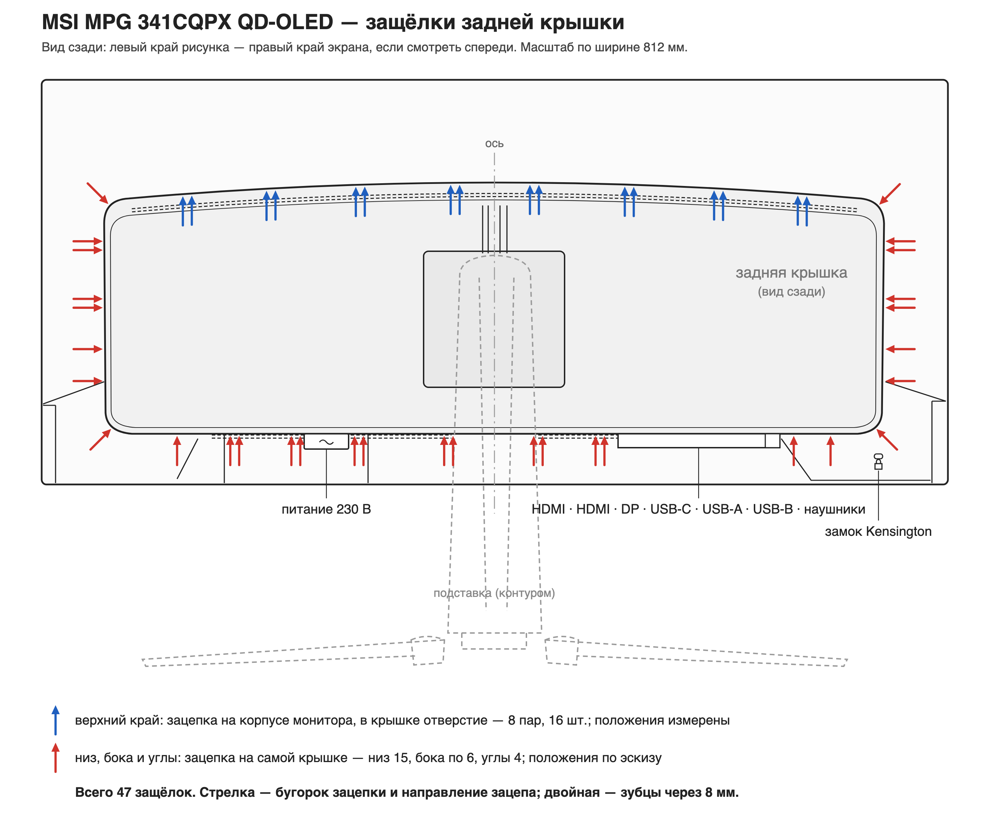

# Разборка монитора: снятие задней крышки

Начальные сведения. Крышка снята вручную **2026-08-09**, монитор не повреждён —
всё ниже проверено на своём экземпляре. Где именно стоят защёлки — раздел
«Карта защёлок».

Это снимает препятствие шага 9 в `docs/PLAN.md` — доступ к платам получен.
Официальной документации на шасси 3DD0 нет, запрос в MSI был отклонён
(«disassembly guide is for qualified service technicians only»), поэтому порядок
разборки установлен опытным путём.

## Что держит крышку

**Только защёлки.** Винтов, скрытых под заглушками винтов и клея нет — после
снятия подставки крышка держится исключительно пластиковыми зацепками по периметру.

Геометрия зацепок **разная у разных краёв**, и это главное, что нужно знать заранее:

| Край крышки | На крышке | На корпусе монитора |
|---|---|---|
| Низ | выступающие зацепки | дырочки |
| Бока | выступающие зацепки | дырочки |
| **Верх** | **дырочки** | **выступающие зацепки** |

То есть низ и бока освобождаются отгибанием края крышки **наружу**, а верхний край
устроен наоборот — крышка там надета на зацепки корпуса.

## Карта защёлок

Составлена 2026-10-11/12 по крышке своего экземпляра. **47 зацепок:**

| Край | Сдвоенных | Одиночных | Всего | Где зацепка | Положения |
|---|---|---|---|---|---|
| Верх | 8 | — | 16 | на корпусе, в крышке отверстие | **измерены** |
| Низ | 6 | 3 | 15 | на крышке | по эскизу |
| Каждый бок | 2 | 2 | 6 | на крышке | по эскизу |
| Углы | — | 4 | 4 | на крышке | по эскизу |

Стрелка на рисунке изображает саму зацепку — её бугорок — и показывает
направление зацепа. Сдвоенная зацепка — два зубца рядом, **8 мм** между центрами
зубцов (измерено, одинаково у всех сдвоенных).

**Верх, замер.** Зацепки симметричны относительно оси монитора. Между внутренними
зубцами двух центральных пар — **63 мм**; дальше от оси шаг пар **85, 80, 75 мм**.
Шаг измерен между одноимёнными зубцами соседних пар, поэтому центры пар —
**±35,5, ±120,5, ±200,5, ±275,5 мм** от оси.

**Остальные края — не замер.** Низ, бока и углы перенесены с рукописного эскиза
(`photo/back_cover_latches_sketch.jpeg`) по ориентирам: углы крышки, ось, разъём
питания, блок разъёмов. Эскиз сверен с крышкой, а готовый рисунок проверен на
правдоподобие, правок не потребовалось, но расстояния в миллиметрах здесь не
измерялись. То, что угловые зацепки стоят на крышке, проверено на крышке.

**Как построен рисунок.** Контур перерисован с вида сзади на стр. 10 руководства
пользователя MPG 341CQPX QD-OLED v1.1 с сайта MSI. Чертёж руководства выполнен
в масштабе: если ширину рамки приравнять к 812 мм из спецификации, высота выходит
≈363 мм, что правдоподобно для панели 34″ 21:9. Это проверка, а не замер. По этому
масштабу миллиметры верхних зацепок переведены в координаты рисунка. Изгиб корпуса
не учтён: в 275 мм от оси дуга и её проекция расходятся примерно на 1 мм.
Картинку собирает `tools/rear_cover_latches.py` (SVG,
`docs/rear_cover_latches.svg`); PNG — снимок SVG через headless Chrome, команда
в заголовке скрипта.

## Порядок

1. Снять подставку.
2. Начинать с **нижнего** края: тянуть край крышки наружу, отщёлкивая зацепки.
3. Продолжать по бокам, от низа вверх.
4. Верхний край освобождается последним.

## Рекомендации

- **Нужны крепкие пластиковые лопатки (спуджеры), а не медиаторы.** Пластик крышки
  довольно жёсткий; медиатор для такого усилия не годится.
  **Проверено на практике:** набор **BGS 1327** («Car Interior Lining Set», лопатки для
  снятия автомобильной обшивки), <https://www.amazon.de/-/en/dp/B00126G0BO>, ASIN
  `B00126G0BO`. Этим набором крышка и была снята, усилия он держит. Ключевое в нём —
  материал: **стеклонаполненный пластик**, он заметно жёстче нейлоновых спуджеров и
  медиаторов, но при этом не царапает и не мнёт корпус, как металл. Автомобильные наборы
  для обшивки вообще подходят здесь лучше «телефонных»: защёлки монитора рассчитаны на
  сравнимое усилие. ASIN записан отдельно от ссылки — ссылки на маркетплейсы живут
  недолго.
- **Нужны крепкие нервы:** защёлки отщёлкиваются с громким звуком и треском. Звук
  пугающий, но сам по себе не означает, что что-то сломалось.
- Ломать нельзя: смысл вскрытия — снять дамп на исправном мониторе.

## Шлейфы

**На задней крышке нет ни светодиодов, ни какой-либо электроники.** К ней ничего не
подключено, шлейфов между крышкой и платами нет — при снятии за них можно не
беспокоиться и крышку можно сразу отложить в сторону. Видно на
`photo/monitor_open_overview.jpeg`: снятая крышка лежит рядом, к ней не идёт ни один
провод.

## Что осталось

- Положения зацепок внизу, на боках и в углах в миллиметрах — замером, как у верхних.
- Порядок дальнейшей разборки (экран, средняя плата) не проверялся и здесь не описан.
